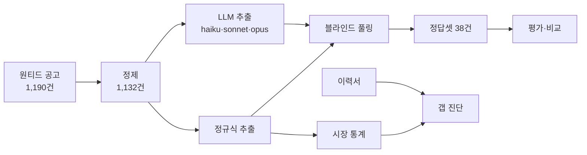

# CareerFit

채용공고에서 요구 역량을 추출해 직무별 시장 지형도를 만들고, 개인 이력과 대조해 학습 우선순위를 진단하는 파이프라인입니다.

이 프로젝트의 중심은 추출 자체가 아니라 **추출 결과가 맞는지 재는 장치**입니다. 정규식 베이스라인과 LLM 3종(Claude haiku · sonnet · opus)을 같은 정답셋으로 비교했고, 그 과정에서 평가 체계의 편향을 두 번 발견해 교정했습니다. 두 번째 교정에서 결론이 뒤집혔습니다.

---

## 핵심 결과

정답셋 38건(블라인드 풀링 재검수 후) 기준. 비용은 고유 공고 892건 전체 처리 시 환산.

| 방식 | F1 | Precision | Recall | ①명시 기술 | ②서술형 역량 | 전체 비용 |
|---|---|---|---|---|---|---|
| Claude opus-5 | **0.855** | 0.782 | 0.942 | 0.929 | **0.766** | $15.70 |
| 정규식 | 0.843 | 0.789 | 0.905 | 0.924 | 0.736 | **$0** |
| Claude sonnet-5 | 0.836 | **0.839** | 0.833 | 0.927 | 0.716 | $6.66 |
| Claude haiku-4.5 | 0.820 | 0.766 | 0.881 | 0.914 | 0.692 | $2.85 |
| **길이 기준 라우팅 (opus 40%)** | **0.854** | 0.780 | 0.942 | — | — | **$6.20** |

- **명시적인 기술명은 정규식으로 충분합니다.** ①명시 기술에서 네 방식이 0.91~0.93으로 사실상 동률입니다.
- **차이는 서술형 역량에서 납니다.** "대용량 데이터 처리 경험" 같은 서술형 요구에서 opus가 앞섭니다(0.766 vs 0.736).
- **긴 공고만 상위 모델로 보내면 비용을 약 60% 줄이면서 opus 단독과 비슷한 정확도를 얻습니다.**

opus와 정규식의 차이(0.012)는 태그 11개 규모입니다. 정답셋 38건에서 확정적 우위로 보기는 어려우며, 근소한 차이로 해석합니다.

---

## 무엇을 발견했나

### 1. 정답셋이 추출기 자신을 채점하고 있었다

처음 정답셋은 정규식이 뽑은 태그를 사람이 확인하는 방식으로 만들었습니다. 그러면 정규식이 못 본 태그는 정답셋에도 들어가지 않습니다. 실제로 자격요건에 "SQL과 Python을 활용해"라고 적힌 공고의 정답에 SQL도 Python도 없었습니다.

정규식과 LLM이 뽑은 태그를 합쳐 **출처를 가리고 순서를 섞어** 다시 판정했습니다(블라인드 풀링).

- 후보 410건 중 116건(28%) 제외
- 38공고 중 **32개에서 정답이 바뀜**
- 정규식-LLM 격차가 **0.091 → 0.024**로 줄어듦. 편향이 격차의 약 4분의 3을 만들고 있었습니다

### 2. 첫 번째 교정 뒤에도 같은 구조의 편향이 남아 있었다

풀링 후보를 정규식과 haiku로만 만들었기 때문에, sonnet·opus만 찾은 태그는 후보에 오른 적이 없었습니다. 맞는 태그여도 오탐으로 채점됐습니다.

이 상태의 결과는 "모델을 키울수록 F1이 떨어진다(opus 최하)"였습니다. 결론을 쓰기 전에 sonnet·opus 단독 태그 30건을 추가 판정하자 **opus가 꼴찌에서 1위로 바뀌었습니다.**

풀링에 참여하지 않은 시스템은 불리하게 채점됩니다. 비교할 모든 시스템을 풀링에 포함해야 합니다.

### 3. 정규식이 원리적으로 못 고치는 오탐이 있다

```
공고 원문:  "refining Grok to excel in voice interactions"
정규식:     ['Excel']   ← 동사 excel을 스프레드시트 도구로 인식
LLM:        []
정답:       []
```

문자열은 정확히 일치하고 단어 경계 판정도 맞았습니다. 사전에서 `excel`을 빼면 진짜 엑셀 요구를 놓치고, 두면 이 오탐이 남습니다. 규칙 기반 추출의 구조적 한계입니다.

### 4. 한국어 조사가 정규식 단어 경계를 깨뜨리고 있었다

파이썬 `\b`는 `\w` 기준이고 `\w`는 한글을 포함합니다. 그래서 "SQL을", "대시보드를"처럼 조사가 붙으면 경계가 사라져 매칭되지 않았습니다.

ASCII 기준 경계와 조사 화이트리스트로 교체한 결과 전체 태그가 **7,360 → 7,889개(+7.2%)**, 공고 892건 중 **490건(55%)**에서 결과가 바뀌었습니다. 영향은 한글 서술형 태그에 집중됐습니다. → [`src/extract/boundary.py`](src/extract/boundary.py)

### 5. 캐스케이드 라우팅은 기준에 따라 성패가 갈린다

API 호출 없이 기존 예측을 섞어 라우팅 정책을 시뮬레이션했습니다. → [`src/eval/cascade_sim.py`](src/eval/cascade_sim.py)

| 라우팅 기준 | 결과 |
|---|---|
| 공고 길이 | 40% 근처에서 opus 단독 수준 도달 |
| 정규식이 찾은 서술형 태그 수 | 20~30%에서 오히려 정규식보다 하락 |

정규식이 서술형을 제대로 못 잡으니, 정규식이 센 서술형 개수로 어려운 공고를 고르는 것 자체가 부정확했습니다.

---

## 파이프라인



| 단계 | 내용 |
|---|---|
| 수집 | 원티드 내부 API 호출. ds·de·mle·da 4개 직무 |
| 정제 | 비데이터 공고 58건 제외(데이터 분석가가 경영 직군에 분류돼 절반이 무관 공고). 교차 직무 중복 제거 시 고유 892건 |
| 추출 | 표준 태그 106개 사전(별칭 293개). 사전 밖 출력은 환각으로 별도 집계 |
| 평가 | 정답셋 38건, precision·recall·F1, 필드 난이도별 분리 |
| 분석 | 직무별 출현율, 동시출현, 신입·경력 비교 |
| 진단 | 우선순위 = 출현율 × 미보유 × 신입 접근성 |

### 에이전트 팀

Claude Code 서브에이전트 3명이 직렬로 동작합니다.

| 담당 | 하는 일 | 도구 권한 |
|---|---|---|
| extractor | 공고에서 역량 태그 추출 | Read, Bash |
| analyst | 직무별 시장 통계 | Read, Bash |
| diagnoser | 이력서와 대조해 학습 우선순위 산출 | Read, Bash |

- 서브에이전트에는 Write/Edit 권한이 없습니다. 다만 Bash가 있으므로 권한만으로 쓰기가 막히지는 않습니다. 실제 보장은 각자 정해진 스크립트만 호출하고, 그 스크립트가 자기 출력 폴더에만 쓴다는 설계 규약입니다.
- 앞 단계 산출물이 없거나 오래되면 자동으로 정지합니다.
- MCP로 Google Drive(이력서 읽기)와 Notion(실행 기록)을 연결했고, 둘 다 메인 세션만 사용합니다.

판단 기준은 숫자로 고정했습니다.

- 출현 3건 미만 → 통계에서 제외
- 직무 간 모집단이 3배 이상 차이 → 절대 건수가 아니라 출현율로만 비교
- 암묵적 조건(예: 협업·커뮤니케이션) → 학습 로드맵에서 제외

---

## 평가 방법

**정답 기준.** 공고가 지원자에게 요구하거나 우대하는 기술만 정답으로 봅니다. 회사 소개나 사내 인프라 설명에만 등장하는 기술은 제외합니다. 공고가 범주만 명시하면("NoSQL 경험") 하위 도구 태그(MongoDB)는 정답으로 인정하지 않습니다.

**블라인드 풀링.** 모든 비교 대상 시스템의 추출 결과를 합쳐 후보를 만들고, 출처를 가린 채 공고 안에서 순서를 섞어 사람이 판정합니다. 판정은 LLM에게 맡기지 않습니다. LLM이 LLM의 결과를 채점하게 되기 때문입니다. → [`src/label/pool_cli.py`](src/label/pool_cli.py)

---

## 한계

- **정답셋이 38건입니다.** 직무별 수치는 표본이 작아 쓰지 않습니다(mle·da 각 5건).
- **풀링은 참여 시스템이 찾은 것만 후보로 올립니다.** 네 방식 모두 놓친 태그는 수기 입력에 의존하며, recall 상한이 남습니다.
- **서술형 역량은 최선도 0.766입니다.** 모델 규모로 해결되지 않는 구간이며, 태그 정의 쪽 문제로 보입니다.
- **라우팅 운영점은 확정하지 않았습니다.** 38건에서 비율을 고르면 과적합입니다. 랜덤 라우팅 대비 검증도 하지 않았습니다.
- **추가 풀링 30건은 블라인드가 약했습니다.** 이미 판정한 공고에 새 후보만 떠서 출처를 짐작할 수 있었습니다.
- **이력서가 외부 드라이브에 있어** 레포만으로는 갭 진단이 재현되지 않습니다.

실패한 실험과 버린 선택은 [`notes/lab_log.md`](notes/lab_log.md)에 기록했습니다.

---

## 재현

공고 원문(`data/raw/*/wanted_*.jsonl`)과 정답셋 본문은 레포에 포함하지 않습니다. 정답셋은 본문을 뺀 [`data/labeled/label_draft.public.jsonl`](data/labeled/label_draft.public.jsonl)로 공개합니다.

```bash
# 1. 정규식 추출
python -m src.extract.job_skill_extract_report

# 2. LLM 추출 (정답셋 38건)
export ANTHROPIC_API_KEY=...
python -m src.extract.llm_skill_extract \
  --raw-dir data/raw --dict data/raw/dict/skill_tags_v1.yaml \
  --out-dir data/processed --date 2026-07-30 \
  --model claude-opus-5 --ids-file data/labeled/gold_ids.txt

# 3. 평가
python -m src.eval.evaluate_extraction --dict-path data/raw/dict/skill_tags_v1.yaml \
  --pred-file data/processed/2026-07-30/llm_extract_claude-opus-5.jsonl \
  --out-dir data/processed/evaluation_llm_opus

# 4. 방식 비교 · 라우팅 시뮬레이션
python -m src.eval.compare_methods --n-docs 892
python -m src.eval.cascade_sim
```

---

## 구조

```
.claude/
  agents/                 서브에이전트 정의 (extractor · analyst · diagnoser)
  skills/careerfit팀-돌리기/  팀 운영 스킬
data/
  raw/dict/               역량 태그 사전
  labeled/                정답셋(공개판) · 풀링 후보 · 판정 결과
  processed/              추출 결과 · 평가 결과 · 비교표
notes/lab_log.md          실험 기록
src/
  crawl/                  수집
  extract/                정규식 · LLM 추출, 한국어 경계 처리
  label/                  정답셋 라벨링 · 블라인드 풀링
  eval/                   평가 · 방식 비교 · 라우팅 시뮬레이션
  analyze/                시장 통계 · 갭 진단
CLAUDE.md                 프로젝트 규칙
```

## 기술

Python · 정규식 · Anthropic API (Claude haiku-4.5 · sonnet-5 · opus-5) · Claude Code 서브에이전트 · MCP (Notion, Google Drive)
