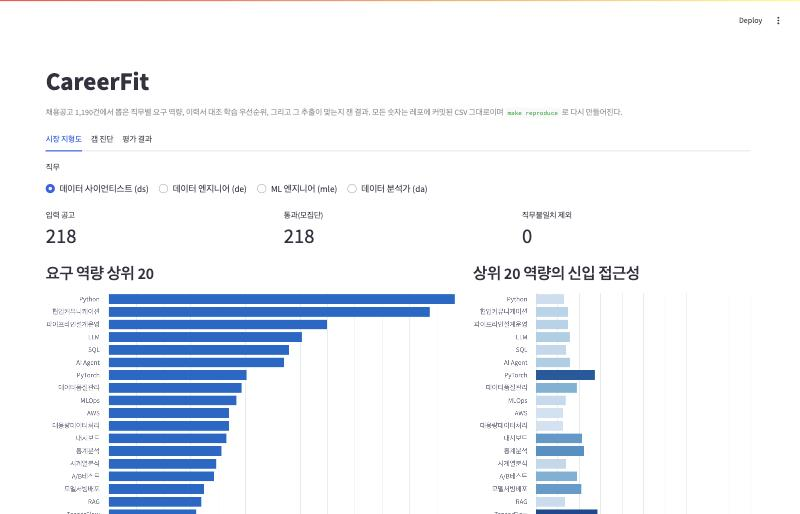
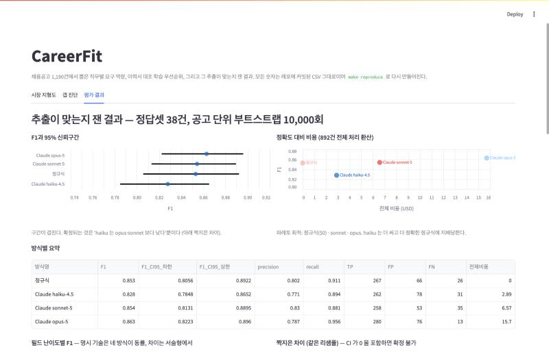
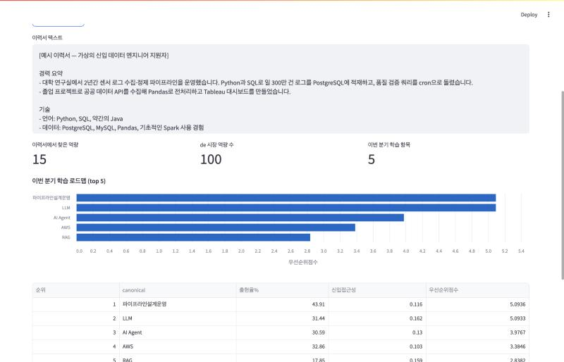
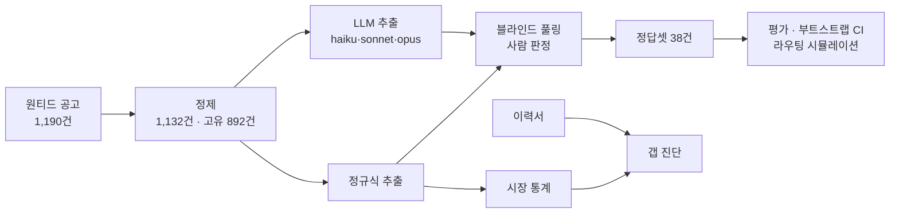

# CareerFit

채용공고 1,190건에서 요구 역량을 추출해 직무별 시장 지형도를 만들고, 개인 이력과 대조해 학습 우선순위를 진단하는 파이프라인입니다.

이 프로젝트의 중심은 추출기가 아니라 **추출 결과가 맞는지 재는 장치**입니다. 정규식 베이스라인과 Claude 3종(haiku · sonnet · opus)을 같은 정답셋으로 비교했고, 그 과정에서 평가 장치 자체의 결함을 네 번 찾아 고쳤습니다. 두 번째 교정에서는 결론이 뒤집혔고, 세 번째에서는 "차이가 있다"는 주장을 "확정할 수 없다"로 바꿨으며, 네 번째(독립 코드 리뷰)에서는 sonnet의 순위가 API 호출 설정 한 건의 산물이었음이 드러나, 그 호출을 다시 받자 sonnet이 파레토 최적에 합류했습니다.

[](.github/workflows/ci.yml) · `make reproduce` 한 줄로 공개 데이터만으로 모든 평가 표가 다시 만들어집니다. · **데모:** https://careerfit-kevin2483.streamlit.app

> **English summary.** Live demo: https://careerfit-kevin2483.streamlit.app · CareerFit extracts required skills from 1,190 Korean job postings (data scientist / engineer / ML engineer / analyst), builds per-role market maps, and diagnoses an individual's skill gaps. The core contribution is the *measurement apparatus*, not the extractor: a regex baseline and three Claude models are scored against a human-labeled gold set built by **blind pooling** (candidates from all systems, source hidden, order shuffled). Four rounds of correction were needed; the last one, from an independent code review, found that sonnet's rank rested on a single response truncated at max_tokens=512 and scored as an empty prediction. Re-issuing that one call moved sonnet from 0.845 to 0.854 and onto the Pareto frontier. Final F1 on 38 postings (dictionary v2, which closes tag sets under one human-confirmed implication rule, PySpark→Spark): opus 0.863, sonnet 0.854, regex 0.853, haiku 0.828. Bootstrap 95% CIs overlap; the opus–regex gap of +0.010 has CI [−0.016, +0.037], so only "haiku is below opus and sonnet" is statistically settled at this sample size. Explicit tool names are solved equally by all methods (F1 0.92–0.95); the difference is entirely in descriptive competencies. Length-based routing of 40% of postings to opus reaches opus-level F1 at 40% of the cost, but is only +1.1σ above random routing. Every evaluation table (`evaluation_{regex_pooled,llm_*}`, bootstrap CIs, method comparison, routing simulation, failure sensitivity) regenerates byte-identically from committed public files via `make reproduce`; CI verifies this on every push.

---

## 핵심 결과

정답셋 38건(블라인드 풀링 재검수 3회 교정 후), 사전 v2(함의 규칙 PySpark→Spark로 정답·예측을 같이 닫음). 신뢰구간은 공고 단위 부트스트랩 10,000회. 비용은 고유 공고 892건 전체 처리 시 환산.

| 방식 | F1 | 95% CI | Precision | Recall | ①명시 기술 | ②서술형 역량 | 전체 비용 |
|---|---|---|---|---|---|---|---|
| Claude opus-5 | **0.863** | [0.822, 0.896] | 0.787 | **0.956** | 0.937 | **0.766** | $15.70 |
| Claude sonnet-5 | 0.854 | [0.813, 0.890] | **0.830** | 0.881 | **0.947** | 0.718 | $6.57 |
| 정규식 | 0.853 | [0.806, 0.892] | 0.802 | 0.911 | 0.937 | 0.736 | **$0** |
| Claude haiku-4.5 | 0.828 | [0.785, 0.865] | 0.771 | 0.894 | 0.922 | 0.692 | $2.89 |
| 길이 기준 라우팅 (opus 40%) | 0.863 | — | 0.792 | 0.949 | — | — | $6.20 |

| 짝지은 차이 | 점추정 | 95% CI | P(차이>0) |
|---|---|---|---|
| opus − regex | +0.010 | [−0.016, +0.037] | 0.77 |
| opus − haiku | +0.035 | [+0.013, +0.059] | 1.00 |
| sonnet − haiku | +0.027 | [+0.001, +0.056] | 0.98 |
| regex − sonnet | −0.001 | [−0.032, +0.028] | 0.46 |

- **명시적인 기술명은 정규식으로 충분합니다.** ①명시 기술에서 네 방식이 0.92~0.95로 사실상 동률입니다.
- **차이는 서술형 역량에서 납니다.** "대용량 데이터 처리 경험" 같은 서술형 요구에서 opus가 앞섭니다(0.766 vs 0.736).
- **opus와 정규식의 차이는 이 표본 크기로 확정할 수 없습니다.** 차이의 신뢰구간이 0을 포함합니다. 확정되는 건 "haiku는 opus와 sonnet보다 낮다"뿐입니다. sonnet과 정규식은 차이가 0.001입니다.
- **파레토 최적은 정규식($0), sonnet($6.57), opus($15.70) 셋입니다.** haiku만 더 싸고 더 정확한 정규식에 지배당합니다. 네 번째 교정 전에는 sonnet도 지배당하는 것으로 나왔습니다(발견 7).
- **비용은 2026-10-28에 공식 단가 페이지로 재확인한 값입니다.** haiku $1/$5, sonnet $2/$10, opus $5/$25 (입력/출력, 백만 토큰당). `method_comparison.csv`의 단가기준일 열에 적혀 있습니다.

---

## 무엇을 발견했나

### 1. 정답셋이 추출기 자신을 채점하고 있었다

처음 정답셋은 정규식이 뽑은 태그를 사람이 확인하는 방식으로 만들었습니다. 그러면 정규식이 못 본 태그는 정답셋에도 들어가지 않습니다. 실제로 자격요건에 "SQL과 Python을 활용해"라고 적힌 공고의 정답에 SQL도 Python도 없었습니다.

정규식과 LLM이 뽑은 태그를 합쳐 **출처를 가리고 순서를 섞어** 다시 판정했습니다(블라인드 풀링). 후보 410건 중 116건(28%)을 제외했고, 정규식-LLM 격차가 **0.091 → 0.024**로 줄었습니다. 편향이 격차의 약 4분의 3을 만들고 있었습니다.

### 2. 첫 교정 뒤에도 같은 구조의 편향이 남아 있었다

풀링 후보를 정규식과 haiku로만 만들었기 때문에, sonnet·opus만 찾은 태그는 후보에 오른 적이 없었습니다. 맞는 태그여도 오탐으로 채점됐습니다. 이 상태의 결과는 "모델을 키울수록 F1이 떨어진다(opus 최하)"였습니다. sonnet·opus 단독 태그 30건을 추가 판정하자 **opus가 꼴찌에서 1위로 바뀌었습니다.** 비교할 모든 시스템을 풀링에 포함해야 합니다.

### 3. 사전과 정답셋의 표기 오류가 점수를 깎고 있었다

전체 코드 검증에서 두 가지를 찾았습니다.

- **사전 alias 충돌.** `mariadb`가 MySQL과 MariaDB 양쪽에, `pyspark`가 Spark와 PySpark 양쪽에 있는 식으로 4건. 그 문자열은 항상 두 태그를 동시에 만들어 정규식 오탐 5건의 원인이었습니다. "정규식이 원리적으로 못 고치는 오탐"을 설명하면서 고칠 수 있는 오탐은 못 보고 있었습니다.
- **정답셋 표기.** 한 공고에서 후보 "FastAPI"를 거부한 뒤 수기로 "fastapi"를 넣어, 네 방식 전부 오탐 1 + 누락 1로 이중 감점되고 있었습니다.

고치고 재채점한 결과가 위 표입니다. 순위는 바뀌지 않았지만, 이때 부트스트랩 신뢰구간을 붙이면서 "opus가 앞선다"를 "확정할 수 없다"로 고쳤습니다. 사전의 충돌은 이제 `load_dict()`가 경고하고 테스트가 막습니다.

alias 충돌을 없애자 반대 문제가 드러났습니다. 정답셋은 "PySpark" 언급을 Spark 요구로도 봤는데, 사전에는 하위 도구가 상위 도구를 함의한다는 규칙이 없어 Spark가 누락으로 바뀌었습니다. 사전 v2는 `implies` 필드로 이 규칙을 적고, 정답·정규식·LLM 예측을 **같은 규칙으로 닫은 뒤** 비교합니다. 규칙은 정답셋이 지지하는 쌍에만 넣었습니다. 후보 쌍 다섯 중 PySpark→Spark만 "하위만 태깅된 정답"이 0건이었고, MariaDB→MySQL·ELK→ElasticSearch·ArgoCD→CI/CD·모델서빙배포→MLOps는 사람이 하위만 정답으로 인정한 공고가 있어 제외했습니다. 효과는 네 방식 모두 +0.004로 같고 순위와 신뢰구간 결론은 바뀌지 않았습니다. 사전의 기존 `parent` 필드는 57건 중 54건이 canonical이 아닌 개념 그룹(RDBMS, ML/DL)이라 함의 규칙으로 쓸 수 없었습니다.

### 4. 정규식이 원리적으로 못 고치는 오탐이 있다

```
공고 원문:  "refining Grok to excel in voice interactions"
정규식:     ['Excel']   ← 동사 excel을 스프레드시트 도구로 인식
LLM:        []
정답:       []
```

문자열은 정확히 일치하고 단어 경계 판정도 맞았습니다. 사전에서 `excel`을 빼면 진짜 엑셀 요구를 놓치고, 두면 이 오탐이 남습니다. 규칙 기반 추출의 구조적 한계입니다.

### 5. 한국어 조사가 정규식 단어 경계를 깨뜨리고 있었다

파이썬 `\b`는 `\w` 기준이고 `\w`는 한글을 포함합니다. 그래서 "SQL을", "대시보드를"처럼 조사가 붙으면 경계가 사라져 매칭되지 않았습니다. ASCII 기준 경계와 조사 화이트리스트로 교체한 결과 전체 태그가 **+7.2%**, 공고 892건 중 **490건(55%)**에서 결과가 바뀌었습니다. 영향은 한글 서술형 태그에 집중됐습니다. → [`src/extract/boundary.py`](src/extract/boundary.py)

### 6. 라우팅은 "작동하는 것처럼" 보였다

API 호출 없이 기존 예측을 섞어 라우팅 정책을 시뮬레이션했습니다. → [`src/eval/cascade_sim.py`](src/eval/cascade_sim.py)

| 라우팅 기준 (opus 40%) | F1 | 비용 |
|---|---|---|
| 공고 길이 상위 40% | 0.863 | $6.20 |
| 무작위 40% (1,000회 평균) | 0.857 ± 0.006 | $6.20 |
| 정규식이 찾은 서술형 태그 수 상위 40% | 0.850 | $6.20 |

길이 기준은 opus 단독(0.863)과 같은 수준을 비용 40%로 얻습니다. 그런데 무작위 라우팅과의 차이는 +1.1σ입니다. 어떤 공고를 보내든 opus를 40% 섞으면 그만큼 오르고, "긴 공고를 고르는 것"이 보태는 몫은 38건에서 구분되지 않습니다. 서술형 태그 수 기준은 무작위보다 못합니다. 정규식이 서술형을 제대로 못 잡으니 그 개수로 어려운 공고를 고르는 것 자체가 부정확했습니다.

### 7. 잘린 응답 한 건이 sonnet의 순위를 만들고 있었다

작성자의 코드 읽기에 묶이지 않도록 독립 리뷰를 따로 돌렸더니, 위 세 번의 교정이 못 본 네 번째 결함이 나왔습니다. sonnet 예측 파일의 공고 한 건(361662)이 `max_tokens=512`에서 잘려 JSON이 닫히지 않았고, 채점기는 이를 "아무 태그도 못 찾음"으로 처리하고 있었습니다. 그 공고의 정답 14개가 전부 누락이 됐고, 이는 당시 sonnet 전체 누락 45건의 31%였습니다.

| | 재호출 전 | 재호출 후 |
|---|---|---|
| sonnet F1 | 0.845 [0.784, 0.885] | **0.854** [0.813, 0.890] |
| sonnet 누락 | 45 | 35 |
| regex − sonnet | +0.008 | −0.001 |
| 파레토 최적 | 정규식 · opus | 정규식 · **sonnet** · opus |

"sonnet은 정규식에 지배당한다"는 말은 모델이 아니라 호출 설정을 재고 있었습니다. 그 공고 하나를 출력 예산 1,024로 다시 호출하자(비용 $0.008) 17개 태그가 정상으로 돌아왔고 sonnet이 파레토 최적에 들어왔습니다. 세 번의 교정은 전부 정답셋 쪽을 봤고 예측 파일 쪽은 보지 않았던 것입니다.

같은 일이 조용히 반복되지 않도록 세 가지를 코드에 넣었습니다. 추출기는 잘린 응답을 예산을 늘려 즉시 재시도하고, 세 채점기는 실패 행을 빈 예측으로 두되 반드시 경고를 찍으며, `failed_rows_sensitivity.csv`가 실패 문서를 뺀 수치를 매번 같이 냅니다(지금은 실패 행이 없어 전체와 같습니다). → [`src/eval/pred_meta.py`](src/eval/pred_meta.py) · [`scripts/rerun_llm_rows.py`](scripts/rerun_llm_rows.py)

---

## 데모

직무별 요구 역량 지형도, 이력서를 붙여 넣으면 나오는 학습 우선순위, 그리고 위 평가 결과를 한 화면에서 봅니다. 공고 원문이나 API 키 없이 레포에 커밋된 CSV와 사전만 읽으므로 데모 숫자는 README 숫자와 같습니다. 갭 진단은 `src/analyze/gap_diagnosis.run()`을 그대로 호출해 산식이 두 벌이 되지 않습니다.

**배포본:** https://careerfit-kevin2483.streamlit.app (Streamlit Community Cloud, 이 레포의 `main`에서 자동 배포)

```bash
make demo          # 로컬 실행 http://localhost:8501
make demo-docker   # 같은 것을 컨테이너로 (이미지에는 커밋된 산출물만 들어간다)
```

| 시장 지형도 | 평가 결과 |
|---|---|
|  |  |



---

## 파이프라인



| 단계 | 내용 | 코드 |
|---|---|---|
| 수집 | 원티드 내부 API. ds·de·mle·da 4개 직무. 원문 통째로 보존 | `src/crawl/` |
| 정제 | 비데이터 공고 58건 제외(데이터 분석가가 경영 직군에 분류돼 절반이 무관). 교차 직무 중복 제거 시 고유 892건 | `src/extract/job_skill_extract_report.py` |
| 추출 | 표준 태그 106개 사전(별칭 288개, 함의 규칙 1건). 한국어 조사 경계 처리. LLM은 닫힌 라벨 공간, 사전 밖 출력은 환각으로 별도 집계 | `src/extract/` |
| 정답셋 | 블라인드 풀링 CLI. 판정은 사람만. LLM에게 묻지 않는다 | `src/label/pool_cli.py` |
| 평가 | precision·recall·F1, 필드 난이도별 분리, 공고 단위 부트스트랩 CI, 랜덤 베이스라인 라우팅 시뮬레이션, 예측 실패 행 민감도 | `src/eval/` |
| 분석 | 직무별 출현율, 동시출현, 신입·경력 비교. 판단 기준은 코드 상수 | `src/analyze/market_stats.py` |
| 진단 | 우선순위 = 출현율 × 미보유 × 신입 접근성. 상위 5개만 이번 분기 | `src/analyze/gap_diagnosis.py` |

### 에이전트 팀

Claude Code 서브에이전트 3명(extractor · analyst · diagnoser)이 직렬로 동작합니다. 셋 다 Write/Edit 권한이 없지만 Bash가 있으므로 권한만으로 쓰기가 막히지는 않습니다. 실제 보장은 각자 정해진 스크립트 하나만 호출하고, 판단 기준이 그 스크립트에 상수로 고정돼 있으며, 앞 단계 산출물이 없거나 오래되면 코드가 멈춘다는 설계입니다. 같은 입력으로 두 번 돌려 바이트 단위로 같음을 확인했습니다. → [`docs/agent_team.md`](docs/agent_team.md)

---

## 평가 방법

**정답 기준.** 공고가 지원자에게 요구하거나 우대하는 기술만 정답으로 봅니다. 회사 소개나 사내 인프라 설명에만 등장하는 기술은 제외합니다. 공고가 범주만 명시하면("NoSQL 경험") 하위 도구 태그(MongoDB)는 정답으로 인정하지 않습니다. → [`notes/labeling_criteria.md`](notes/labeling_criteria.md)

**블라인드 풀링.** 비교 대상 시스템 전부의 추출 결과를 합쳐 후보를 만들고, 출처를 가린 채 공고 안에서 순서를 섞어 사람이 판정합니다. 후보 439건, 제외 127건, 38공고 중 35개에서 정답이 바뀌었습니다. 판정을 LLM에게 맡기지 않습니다. LLM이 LLM의 결과를 채점하게 되기 때문입니다.

**통계.** F1의 95% 신뢰구간은 공고 단위 복원추출 10,000회의 percentile입니다. 방식 간 차이는 같은 리샘플에서 짝지어 계산합니다. 라우팅은 무작위 라우팅 1,000회 분포와 비교합니다.

---

## 한계

- **정답셋이 38건입니다.** 신뢰구간 폭(±0.04)이 방식 간 차이(0.01~0.03)보다 넓어 어떤 순위도 확정되지 않습니다. 직무별 수치는 표본이 더 작아(mle·da 각 5건) 쓰지 않습니다.
- **풀링은 참여 시스템이 찾은 것만 후보로 올립니다.** 네 방식 모두 놓친 태그는 수기 입력 3건에 의존하며, recall 상한이 남습니다.
- **서술형 역량은 최선도 0.766입니다.** 모델 규모로 해결되지 않는 구간이며, 태그 정의 쪽 문제로 보입니다.
- **추가 풀링 30건은 블라인드가 약했습니다.** 이미 판정한 공고에 새 후보만 떠서 출처를 짐작할 수 있었습니다.
- **함의 규칙은 정답셋을 보고 골랐습니다.** v2의 PySpark→Spark는 의미상으로도 타당하지만(PySpark는 Spark의 Python API), 어느 쌍을 넣을지는 38건 정답셋의 동시출현을 보고 정했습니다. 평가 데이터로 사전을 다듬은 것이므로 이 +0.004는 과적합일 수 있습니다. 정답셋이 커지면 다시 봐야 합니다.
- **이력서가 외부 드라이브에 있어** 레포만으로는 갭 진단이 재현되지 않습니다. 로컬 텍스트 파일로는 같은 산식으로 돌릴 수 있습니다.
- **sonnet 예측 38건 중 1건은 조건이 다릅니다.** 361662는 2026-10-29에 출력 예산 1,024로 다시 받은 응답이고 나머지 37건은 2026-08에 512로 받았습니다. 모델 버전은 같습니다.
- **운영 요소는 범위 밖입니다.** 데모는 Streamlit Community Cloud와 Docker 이미지로 띄울 수 있지만 모니터링, 오토스케일, 인증은 넣지 않았습니다. 이 프로젝트의 주제는 측정이지 서빙이 아닙니다.
- **단계 순서 보장은 파일 수정 시각에 의존합니다.** 앞 단계 산출물이 더 새로우면 코드가 멈추지만, git clone 직후에는 수정 시각이 체크아웃 시각이라 이 검사가 약합니다.

실패한 실험과 버린 선택, 네 번의 교정 경위는 [`notes/lab_log.md`](notes/lab_log.md)에 날짜순으로 있습니다.

---

## 재현

공고 원문과 정답셋의 본문은 레포에 포함하지 않습니다. 대신 **정답셋 공개판(본문 제거)과 네 방식의 예측 파일**을 커밋해 두어, 평가·비교·신뢰구간·라우팅 시뮬레이션은 API 호출 없이 전부 다시 만들어집니다. CI가 매 push마다 커밋된 CSV와 바이트 단위로 같은지 확인합니다.

```bash
pip install -r requirements.txt
make test        # pytest 76건
make reproduce   # evaluation_{regex_pooled,llm_*} · bootstrap_ci · method_comparison · cascade_sim · failed_rows_sensitivity 재생성
make check       # 재생성 결과가 커밋본과 같은지 diff
```

원문(`data/raw/*/wanted_YYYY-MM-DD.jsonl`)이 있을 때만 가능한 단계:

```bash
python -m src.crawl.wanted --job-group-id 518 --job-ids 1024 --target 300 --out-dir data/raw/ds
make extract     # 정규식 추출 + 정답셋용 regex 예측 파일
make stats       # 시장 통계
python -m src.analyze.gap_diagnosis --job de --resume-file resume.txt

export ANTHROPIC_API_KEY=...
python -m src.extract.llm_skill_extract --raw-dir data/raw --dict data/raw/dict/skill_tags_v2.yaml \
  --out-dir data/processed --date 2026-07-30 --model claude-opus-5 --ids-file data/labeled/gold_ids.txt
```

모든 스크립트는 `--date`를 받습니다. 생략하면 추출 단계는 `data/raw`의 최신 배치를, 평가 단계는 예측 파일이 있는 `data/processed`의 최신 배치를 고릅니다. 날짜와 파일명은 코드에 박혀 있지 않습니다. `data/processed/evaluation_v0`·`v1`·`v1_patched`·`v1_typofix`는 이전 사전·정답셋으로 만든 역사 기록이며 재생성 대상이 아닙니다.

---

## 구조

```
.claude/
  agents/                   서브에이전트 정의 (extractor · analyst · diagnoser)
  skills/careerfit팀-돌리기/   팀 운영 절차
data/
  raw/dict/                 역량 태그 사전 v0 · v1 · v2 (v2 = v1 + 함의 규칙)
  labeled/                  정답셋 공개판 · 풀링 후보 · 판정 키
  processed/<date>/         예측 파일 4종 (regex · haiku · sonnet · opus) + LLM 비용·지연 요약
  processed/evaluation_*/   방식별 평가 (eval_summary · error_analysis)
  processed/                bootstrap_ci · method_comparison · cascade_sim · failed_rows_sensitivity · 시장 통계
demo/                       Streamlit 데모 (app.py · 로더 · 예시 이력서). 커밋된 산출물만 읽는다
docs/agent_team.md          에이전트 팀 설계와 재현성 검증 기록
notes/                      실험 로그 · 라벨링 기준
scripts/                    일회성 마이그레이션 (사전 v1 생성, 정답셋 정규화·교정, 공개판 생성, 예측 행 재호출)
src/
  common/                   JSONL 읽기 · 사전 로딩 · 경로/날짜 해석 (하드코딩 금지 지점)
  crawl/                    수집
  extract/                  정규식 · LLM 추출, 한국어 경계 처리
  label/                    정답셋 라벨링 · 블라인드 풀링
  eval/                     평가 · 부트스트랩 CI · 방식 비교 · 라우팅 시뮬레이션
  analyze/                  시장 통계 · 갭 진단
tests/                      76건. 경계 규칙 · 사전 함의 · 불변식 · 산식 · 풀링 반영 · 결정성 · LLM 출력 파싱 · 실패 행 판정
CLAUDE.md                   에이전트 팀 운영 규칙
```

## 기술

Python 3.12 · 정규식 · Anthropic API (Claude haiku-4.5 · sonnet-5 · opus-5) · Claude Code 서브에이전트 · MCP (Notion, Google Drive) · pytest · GitHub Actions · Streamlit

## 라이선스

MIT. 공고 원문과 정답셋 본문은 레포에 포함하지 않으며, 라이선스는 코드·사전·공개 정답셋(태그만)에 적용됩니다.
